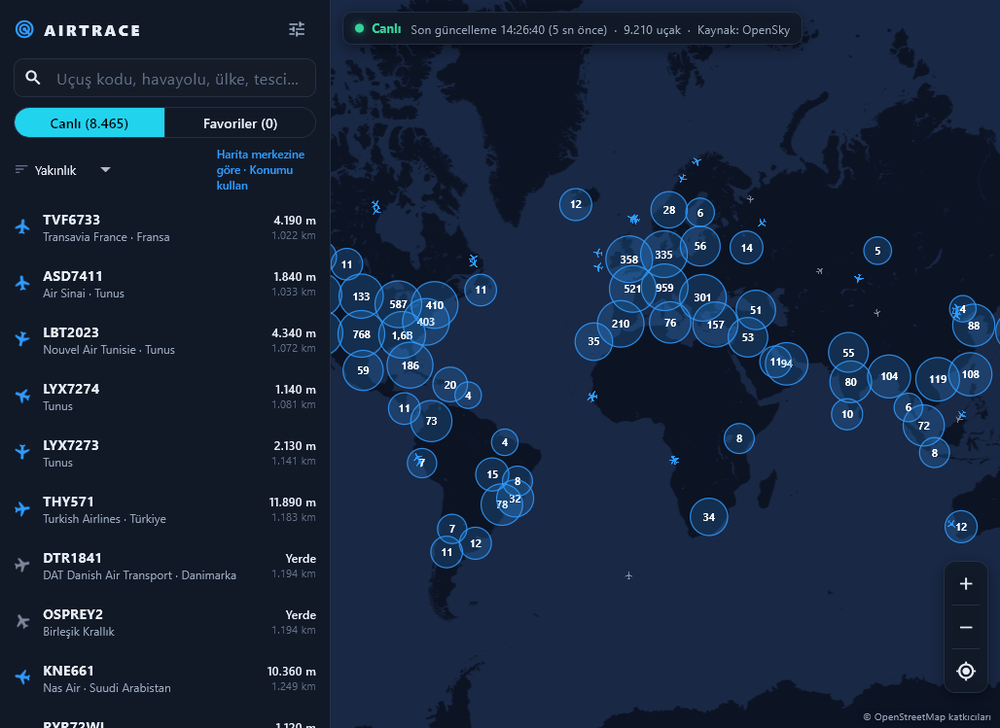
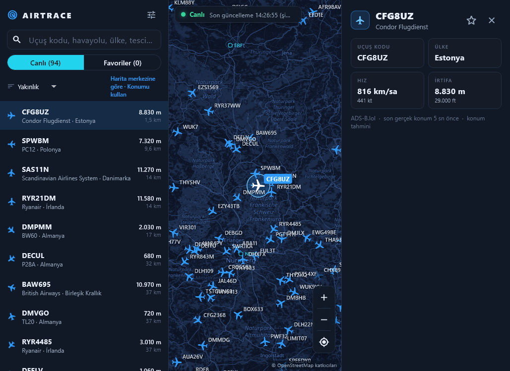
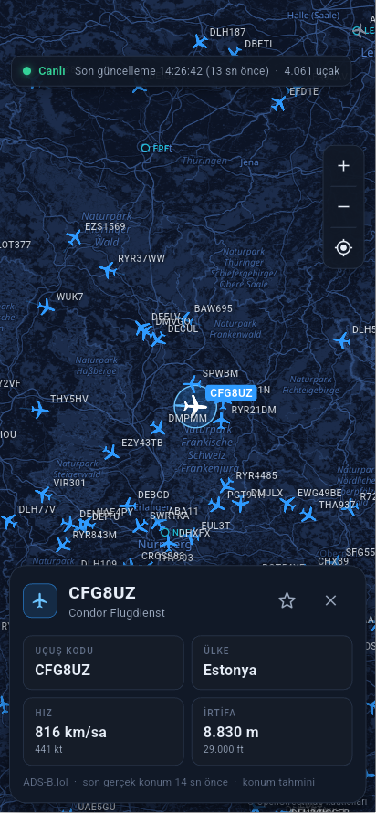
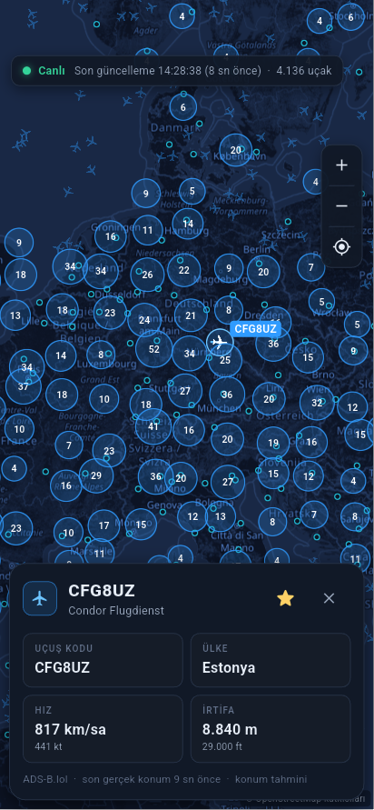

<p align="center">
  
</p>

<h1 align="center">AIRTRACE</h1>

<p align="center">
  <b>Windows ve Android için canlı uçak takip uygulaması</b><br>
  Gerçek ADS-B verisi · Tek Flutter kod tabanı · Performans öncelikli tasarım
</p>

<p align="center">
  
  
  
  
</p>

---

## İçindekiler
- [Özellikler](#özellikler)
- [Ekran görüntüleri](#ekran-görüntüleri)
- [Mimari](#mimari)
- [Canlı veri stratejisi](#canlı-veri-stratejisi)
- [Performans](#performans)
- [Kurulum](#kurulum)
- [Geliştirme](#geliştirme)
- [Testler](#testler)
- [API yapılandırması](#api-yapılandırması)
- [Güvenlik ve gizlilik](#güvenlik-ve-gizlilik)
- [Bilinen sınırlamalar](#bilinen-sınırlamalar)
- [Lisans ve atıflar](#lisans-ve-atıflar)

## Özellikler

| | |
|---|---|
| 🌍 **Canlı dünya haritası** | Koyu lacivert/antrasit tema, ülke sınırları, şehirler, büyük uluslararası havalimanları |
| ✈️ **Gerçek uçaklar** | ADS-B.lol + OpenSky Network. Sahte veya rastgele uçak **asla** üretilmez |
| 🧭 **Yöne dönen simgeler** | Uçak simgeleri gerçek rotaya göre döner. Etiketler yakınlaştırmaya göre görünür. Yoğun bölgelerde kümelendirme yapılır |
| 〰️ **Akıcı hareket** | Yeni veri gelene kadar kontrollü ara değerleme (en fazla 60 sn). Tahmini konum, gerçek veriden ayrı işaretlenir |
| 🛤️ **İz ve rota** | Kısa hareket izi yalnızca gerçek konumlardan çizilir. Kalkıştan bugüne rota yalnızca doğrulanmış (*plausible*) veri varsa gösterilir |
| 🪪 **Bilgi kartı** | Uçuş kodu, ülke, hız, irtifa. Eksik bilgi "Bilinmiyor" olarak gösterilir, uydurulmaz |
| 🔎 **Arama** | Uçuş kodu, havayolu, ülke, tescil, tip veya ICAO hex. Önce bellekte arar, gerekirse tek bir ağ sorgusu yapar |
| ⭐ **Favoriler** | Cihazda yerel olarak saklanır. Uçak canlı veriden kaybolsa bile favori kaydı korunur |
| 📶 **Bağlantı yönetimi** | Son güncelleme zamanı gösterilir. Bağlantı yokken son veriler "eski" etiketiyle kalır ve bağlantı gelince otomatik yenilenir |
| 📍 **İsteğe bağlı konum** | Konum izni yalnızca "Konumuma dön" veya yakınlık sıralaması için istenir. Uygulama izinsiz de tam çalışır |

**Ekran düzeni**
- **Windows:** sol tarafta uçak listesi, ortada dünya haritası, sağda açılır bilgi paneli
- **Android:** tam ekran harita, alttan açılan liste, seçili uçak için alt kart

## Ekran görüntüleri

<p align="center">
  
  
</p>
<p align="center">
  
  
</p>

> Görüntüler, CI'daki uçtan uca testlerin gerçek veriyle çalışırken aldığı ekran görüntüleridir.

## Mimari

```
lib/
├── main.dart                       Giriş noktası
└── src/
    ├── app.dart                    Servis kurulumu (bağımlılık bağlama), tema, Türkçe yerelleştirme
    ├── app_scope.dart              Servisleri widget ağacına taşıyan InheritedWidget
    ├── core/                       Tema (renk paleti) ve Türkçe birim biçimlendirme
    ├── data/
    │   ├── sources/                ADS-B.lol ve OpenSky istemcileri, tek HTTP geçidi, hata tipleri
    │   ├── models/aircraft.dart    Değişmez uçak durumu (SI birimleri)
    │   ├── static_data.dart        Havalimanı / havayolu / ICAO ülke blokları (çevrimdışı, ~140 KB)
    │   ├── favorites_store.dart    Yerel favoriler (SharedPreferences)
    │   ├── route_service.dart      Doğrulanmış kalkış–varış bilgisi
    │   └── location_service.dart   İsteğe bağlı konum
    ├── domain/
    │   ├── live_traffic_controller.dart  Tek zamanlayıcılı veri döngüsü, limit ve geri çekilme yönetimi
    │   ├── fetch_planner.dart            Görünüme göre kaynak seçimi + OpenSky kredi bütçesi
    │   ├── traffic_store.dart            Artımlı güncellenen trafik deposu ve izler
    │   ├── interpolation.dart            Sınırlı ara değerleme (dead reckoning)
    │   ├── clustering.dart               O(n) ızgara kümelendirme
    │   ├── search.dart / sorting.dart    Türkçe duyarlı arama, sıralama
    │   └── selection_controller.dart     Seçim, rota, harita odaklama
    └── ui/
        ├── home_page.dart          Duyarlı düzen (masaüstü ≥ 900 px / mobil)
        ├── map/                    Harita, uçak (GPU atlas) ve havalimanı katmanları
        └── widgets/                Liste, bilgi kartı, durum çubuğu, kontroller, ayarlar
```

**Teknoloji seçimleri**

| Katman | Seçim | Neden |
|---|---|---|
| Çerçeve | Flutter (stable) | Windows ve Android için tek kod tabanı, yerel performans |
| Harita | [flutter_map](https://pub.dev/packages/flutter_map) 8 | Saf Dart olduğu için iki platformda aynı davranır. API anahtarı ve ücret gerektirmez, yerleşik disk önbelleği vardır |
| Altlık | OpenStreetMap + GPU renk matrisiyle lacivert "kontrol merkezi" tonu (isteğe bağlı: CARTO Dark Matter) | Anahtarsız ve ücretsiz. CARTO, Eylül 2026'dan beri anahtar istediği için varsayılan yapılmadı; kullanıcı ücretsiz anahtarını Ayarlar'dan girebilir |
| Durum | `ChangeNotifier` + `ListenableBuilder` | Ek paket gerektirmez, öğrenmesi ve bakımı kolaydır |
| Depolama | `shared_preferences` | Favoriler ve ayarlar için yeterli, hafif |
| Konum | `geolocator` | Windows ve Android desteği var |

Toplam doğrudan bağımlılık: **5 paket** (flutter_map, latlong2, http, shared_preferences, geolocator).

## Canlı veri stratejisi

Veri sağlayıcıları karşılaştırması (Kasım 2026):

| Sağlayıcı | Ücret | Anahtar | Limit | Kapsam | Seçim |
|---|---|---|---|---|---|
| **ADS-B.lol** | Ücretsiz | Gerekmez | Dinamik (sunucu yüküne göre) | Nokta sorgusu en fazla 250 nm | **Birincil**: yakın görünüm |
| **OpenSky Network** | Ücretsiz (ticari olmayan) | İsteğe bağlı | Anonim 400, hesapla 4.000 kredi/gün | Tüm dünya tek sorguda (4 kredi) | **Geniş görünüm** |
| adsb.fi | Ücretsiz (kişisel) | Gerekmez | 1 istek/sn | 250 nm | Yedek adayı |
| FlightAware / FR24 | Ücretli | Gerekir | — | — | Elendi |

`FetchPlanner` her yenileme turunda görünüme bakarak en verimli stratejiyi seçer:

1. **Görünüm 250 nm'ye sığıyorsa** sadece ADS-B.lol kullanılır, **10 sn**'de bir yenilenir.
2. **Bölge ölçeğinde** OpenSky sınır kutusu kullanılır, merkez çember ise ADS-B.lol ile canlı tutulur.
3. **Kıta veya dünya ölçeğinde** sadece OpenSky kullanılır.
4. **OpenSky kotası dolarsa veya erişilemezse** uygulama otomatik olarak ADS-B.lol merkez çemberine geçer ve bunu kullanıcıya açıkça söyler.

**OpenSky kredi bütçesi:** Saat başına kalan kredinin en fazla **%25'i** harcanır. Anonim kullanımda istekler en sık 60 sn, hesapla 20 sn aralıkla gönderilir. Kalan kredi, sunucunun `X-Rate-Limit-Remaining` başlığından okunur. 429 yanıtı gelirse `Retry-After` süresine uyulur.

**Diğer kurallar:**
- İstekler hiçbir zaman üst üste binmez.
- Uygulama arka plandayken veya simge durumundayken **hiç istek gönderilmez**.
- Hata alınınca bekleme süresi katlanarak uzar (5 → 10 → 20 → 40 sn).

## Performans

- **Tek çizim çağrısı:** Tüm uçaklar `Canvas.drawRawAtlas` ile tek seferde GPU'ya gönderilir. Uçak başına widget oluşturulmaz.
- **Uyarlanır kare hızı:** Dünya görünümünde 1 kare/sn, orta yakınlıkta 4, yakında 15 ve çok yakında 30 kare/sn çizilir. Arka planda çizim tamamen durur.
- **Artımlı güncelleme:** Yeni veride sadece değişen uçaklar güncellenir. Liste en fazla saniyede bir yeniden hesaplanır.
- **Sınırlı bellek kullanımı:**
  - İz en fazla 240 nokta ve 30 dakika tutulur.
  - Etiket önbelleği sınırlıdır.
  - Harita önbelleği diskte en fazla **200 MB** yer kaplar (flutter_map varsayılanı 1 GB).
  - Eski uçak kayıtları kontrollü olarak temizlenir.
- **Düşük veri kullanımı:**
  - Retina altlık indirilmez.
  - Statik veriler uygulamayla birlikte gelir (~140 KB).
  - Arama önce bellekte yapılır.

## Kurulum

**Windows 10/11**

`AIRTRACE_Setup.exe` dosyasını çalıştırın. Kurulum yönetici izni istemez; masaüstü ve Başlat menüsü kısayolu oluşturur. Uygulamayı Denetim Masası → Programlar bölümünden kaldırabilirsiniz.

> Kurulum dosyası ücretli bir kod imzalama sertifikasıyla imzalanmadığı için Windows SmartScreen "Bilinmeyen yayıncı" uyarısı gösterebilir. Devam etmek için **Ek bilgi → Yine de çalıştır** seçeneğini kullanın.

**Android 7.0+**

`AIRTRACE.apk` dosyasını telefona kopyalayıp açın. İstenirse "bilinmeyen kaynaklardan yüklemeye" izin verin.

## Geliştirme

```bash
flutter pub get
flutter run -d windows        # veya: flutter run -d <android-cihaz>
```

- **Statik verileri yeniden üretmek için:** `python3 tool/build_data.py <airports.csv> <airlines.dat> <flags.js> assets/data`
- **Platform dosyaları:** Bunlar bir kez `bootstrap-platforms` iş akışıyla üretildi (`flutter create` ve `tool/patch_platforms.py`).

**CI (GitHub Actions):**
- `analyze` ve testler
- Windows derlemesi, Inno Setup kurulumu, kurulum/açılış/kaldırma testi ve uçtan uca test
- Android APK derlemesi ve emülatörde uçtan uca test

Derlenen dosyalar herkese açık **yayınlanmaz**. Teslimat paketi geliştiricinin `age` açık anahtarıyla şifrelenir (`ci/delivery_recipient.txt`).

## Testler

| Katman | Kapsam |
|---|---|
| Birim (`test/unit`) | Ayrıştırıcılar, birim dönüşümleri, ara değerleme, uçak yönü dönüşümü, ICAO→ülke, depo birleştirme/temizlik, veri planlayıcı, OpenSky bütçesi, arama, sıralama, kümelendirme, favori kalıcılığı |
| Widget (`test/widget`) | İnternet yokken masaüstü ve mobil düzen: boş harita, açık uyarı, sahte uçak yok |
| Canlı API (`test/live`) | ADS-B.lol ve OpenSky'a **gerçek** istek, konumların sorgu alanında olduğunun doğrulanması |
| Uçtan uca (`integration_test`) | Gerçek uygulama ve gerçek veriyle: açılış, ilk veri, yakınlaştırma, konum doğruluğu, bilgi kartı, favori kalıcılığı, arama, harita kontrolleri, istek limiti, bağlantı kesilmesi ve yeniden bağlanma, bellek ölçümü. Windows ve Android emülatöründe çalışır |

Son sürümün ayrıntılı sonuçları: **[docs/TEST_RAPORU.md](docs/TEST_RAPORU.md)**

```bash
flutter test --exclude-tags live            # birim + widget
flutter test --tags live test/live          # gerçek ağ
flutter test integration_test -d windows    # uçtan uca
```

## API yapılandırması

Uygulama **hiçbir API anahtarı olmadan** çalışır. Kaynak kodda anahtar yoktur.

OpenSky ile geniş görünümü daha sık yenilemek isterseniz:

1. [opensky-network.org](https://opensky-network.org) üzerinde ücretsiz hesap açın.
2. Hesap sayfasında **API Client** oluşturun.
3. AIRTRACE'te **⚙ Hakkında ve ayarlar** bölümüne *Client ID* ve *Client Secret* bilgilerini girin.

Bu bilgiler sadece o cihazın uygulama verisinde saklanır ve loglanmaz. OAuth2 *client credentials* akışıyla kullanılır.

## Güvenlik ve gizlilik

- **İzinler:**
  - Android: yalnızca İnternet, ağ durumu ve (isteğe bağlı) konum izni istenir.
  - Bildirim izni **istenmez**, hesap sistemi yoktur.
- **Veri:**
  - Kullanıcı verisi toplanmaz.
  - Konum hiçbir sunucuya gönderilmez, sadece haritayı ortalamak ve sıralamak için kullanılır.
  - HTTP yanıtları ve kimlik bilgileri loglanmaz.
- **Bağımlılıklar:** Tüm bağımlılıklar pub.dev'deki yaygın ve bakımı süren paketlerdir (BSD/MIT/Apache).

## Bilinen sınırlamalar

- **Görünmeyen uçaklar:** ADS-B yayını yapmayan uçaklar, alıcı bulunmayan bölgelerdeki uçaklar (okyanuslar, bazı ülkeler) ve gizlilik programlarındaki (LADD/PIA) uçaklar görünmeyebilir.
- **Ücretsiz katman sınırı:** OpenSky'ın anonim kotası dünya görünümünde yaklaşık 2,5 dakikada bir yenilemeye izin verir. Ücretsiz hesapla bu süre 20 sn'ye iner.
- **Rota bilgisi:** Uçuş koduna dayalı kalkış–varış bilgisi her uçuş için mevcut değildir. Doğrulanmamış rotalar çizilmez.
- **Güncelleme yolu:** Uygulama içi güncelleme yoktur. Yeni sürüm, yeni kurulum dosyasıyla yüklenir.

## Lisans ve atıflar

AIRTRACE kaynak kodu © 2026 Furkan Baykal, tüm hakları saklıdır (bkz. [LICENSE](LICENSE)).

| Bileşen | Lisans / Atıf |
|---|---|
| Harita verisi | © [OpenStreetMap](https://www.openstreetmap.org/copyright) katkıcıları (ODbL) |
| Altlık | [OpenStreetMap](https://operations.osmfoundation.org/policies/tiles/) tile sunucusu (kullanım politikasına uygun: tanımlı User-Agent, önbellek, atıf); isteğe bağlı © [CARTO](https://carto.com/attributions) |
| Uçak verisi | [ADS-B.lol](https://adsb.lol) (ODbL 1.0), [The OpenSky Network](https://opensky-network.org) |
| Havalimanları | [OurAirports](https://ourairports.com/data/) (Kamu malı) |
| Havayolları | [OpenFlights](https://openflights.org/data) (ODbL 1.0) |
| ICAO adres blokları | ICAO Annex 10 Vol. III tahsisleri ([tar1090](https://github.com/wiedehopf/tar1090) derlemesi) |
| Ülke adları | Unicode CLDR |
| Harita motoru | flutter_map (BSD-3-Clause) |
